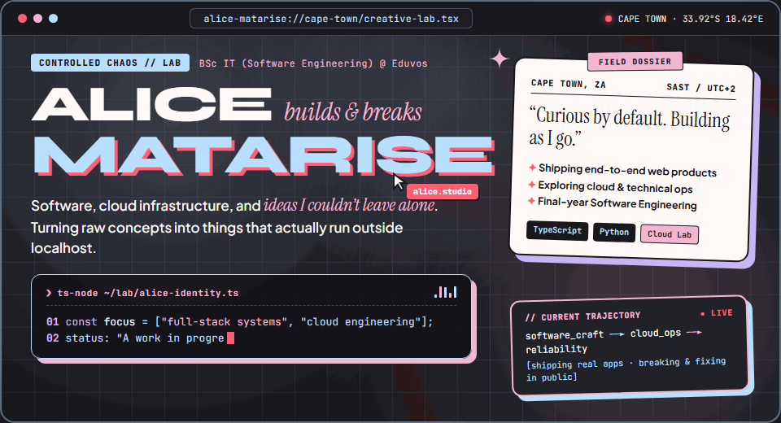
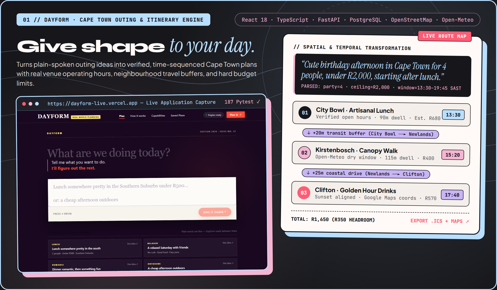
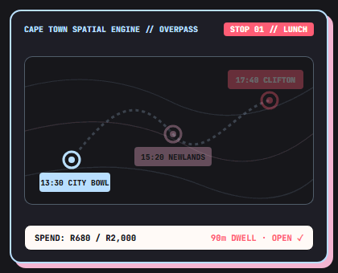
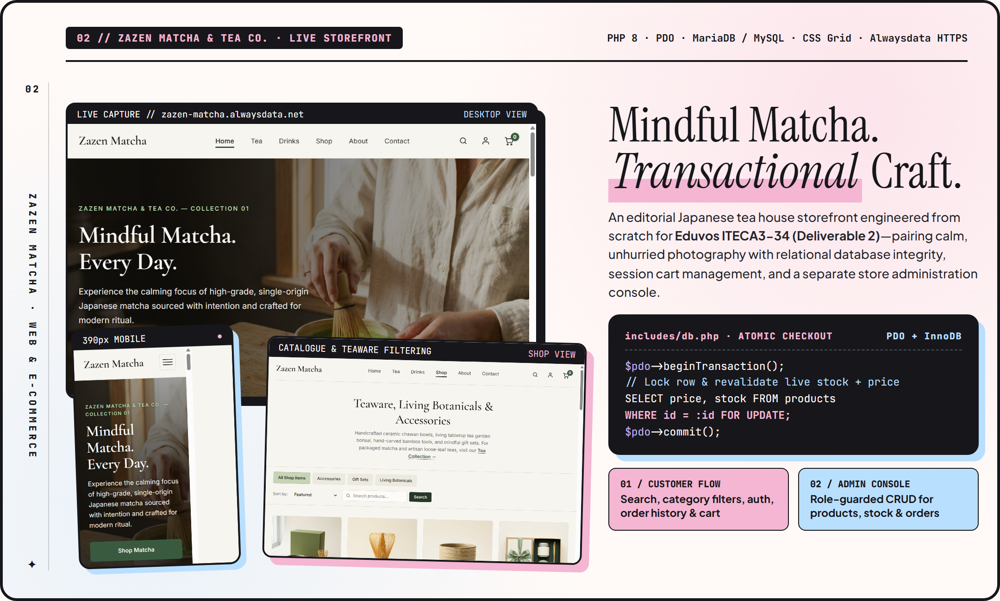
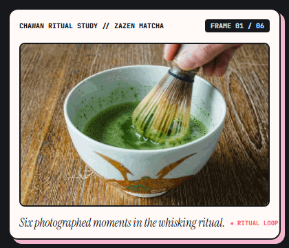
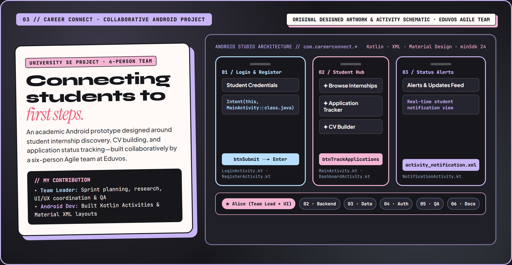
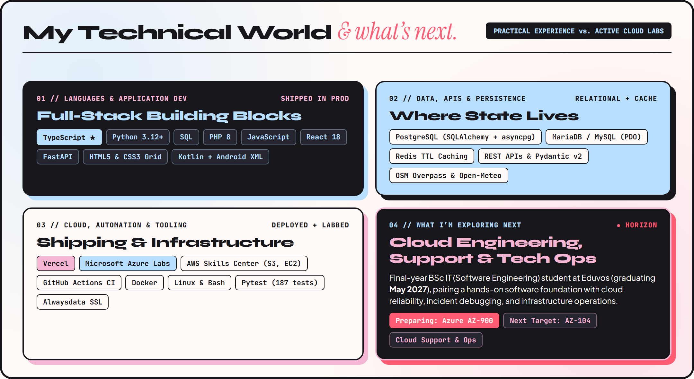
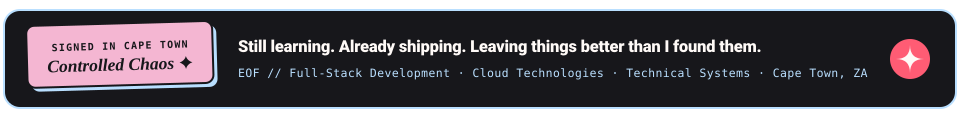

<!-- ======================================================================= -->
<!-- 00 // CINEMATIC HERO — ANIMATED LAB STAGE (.GIF) + TYPEWRITER (.SVG)    -->
<!-- ======================================================================= -->

 

<kbd>CAPE TOWN, SOUTH AFRICA · 33.92°S 18.42°E</kbd> &nbsp;✦&nbsp; <kbd>BSc IT (SOFTWARE ENGINEERING) @ EDUVOS</kbd> &nbsp;✦&nbsp; [<kbd>✉ alicematarise@gmail.com</kbd>](mailto:alicematarise@gmail.com) &nbsp;✦&nbsp; [<kbd>↗ LinkedIn</kbd>](https://www.linkedin.com/in/alice-matarise-422646273/)

 

### `00 // FIELD NOTES` — *Creative chaos, but make it good.*

I’m **Alice Matarise**—a final-year **BSc in IT (Software Engineering)** student at **Eduvos in Cape Town** (*graduating May 2027*) who learns best by building real things, testing them against reality, and figuring out why they broke at 2 a.m.

My work sits at the intersection of **full-stack software engineering** and **cloud infrastructure, technical support, and operations**. I care as much about how an interface *feels*—its pacing, typography, and personality—as I do about what happens underneath when a request hits the database, an upstream API times out, or a deployment goes live.

> *"Curious by default. Building as I go—turning raw concepts into software that actually runs outside localhost."*

| `BASE` | `ACADEMIC TRACK` | `SIGNATURE STACK` | `NEXT HORIZON` |
| :--- | :--- | :--- | :--- |
| Cape Town, ZA (`SAST`) | BSc IT (Software Engineering) · May 2027 | `TypeScript` · `Python` · `SQL` · `PHP` · `Kotlin` | Cloud Engineering, Support & Ops (`AZ-900` → `AZ-104`) |

 

---

<!-- ======================================================================= -->
<!-- 01 // DAYFORM — CAPE TOWN OUTING & ITINERARY ENGINE                     -->
<!-- ======================================================================= -->

  

 

### `01 // DAYFORM` — *Discovering Places & Shaping Outings*

**[Launch Live Application ↗](https://dayform-live.vercel.app/)** &nbsp;·&nbsp; **[Explore Source Repository ↗](https://github.com/SimplyAlice/dayform)**

Planning an afternoon out in Cape Town usually turns into fifteen open browser tabs—cross-checking kitchen closing hours, drive times between the City Bowl and the Southern Suburbs, weather forecasts, and how fast the bill is climbing. **Dayform** turns a plain-spoken prompt into a verified, time-sequenced itinerary.

- **Spatial & Temporal Feasibility**: Parses natural-language requests (*party size, Rand ceiling, vibe, neighbourhood, time window*) and sequences multi-stop routes with real operating hours, dwell times, and inter-stop transit buffers.
- **Live Context Enrichment**: Integrates **OpenStreetMap Overpass** for Cape Town venue discovery and **Open-Meteo** for weather-aware scheduling, exporting ready-to-use `.ics` calendar files and Google Maps links.
- **Engineered for Reliability**: Built with **React 18 + TypeScript (Vite)** and an async **FastAPI + Python 3.12+** backend using **PostgreSQL (`SQLAlchemy 2.0` + `asyncpg`)**, **Redis TTL caching**, and **187 automated Pytest tests**.

 

 

---

<!-- ======================================================================= -->
<!-- 02 // ZAZEN MATCHA & TEA CO. — EDITORIAL JAPANESE E-COMMERCE            -->
<!-- ======================================================================= -->

  

 

### `02 // ZAZEN MATCHA` — *Mindful Matcha, Transactional Craft*

**[Visit Live Storefront ↗](https://zazen-matcha.alwaysdata.net/)** &nbsp;·&nbsp; **[Explore Source Repository ↗](https://github.com/SimplyAlice/Zazen-Matcha)**

Designed and engineered from scratch for **Eduvos ITECA3-34 (Deliverable 2)**, **Zazen Matcha & Tea Co.** pairs the calm, tactile atmosphere of a modern Japanese tea house with a custom relational e-commerce backend—without leaning on heavy frontend frameworks or pre-built store templates.

- **Editorial Storefront & Whisking Ritual**: Responsive **CSS Grid + custom properties** design system featuring live keyword search, category filtering (*Ceremonial Matcha, Hojicha, Chawan Bowls, Chasen Whisks*), and a photographed six-frame matcha preparation sequence.
- **Atomic Database Integrity**: Engineered in **PHP 8 (`PDO` prepared statements)** with **MariaDB / MySQL (`InnoDB`)**. Checkout wraps stock verification and order creation inside an explicit database transaction (`SELECT price, stock FROM products WHERE id = :id FOR UPDATE`) so live inventory can never be oversold.
- **Role-Guarded Admin Console**: Dedicated `/admin` workspace with session security, CSRF verification, and full CRUD management across products, stock levels, and customer orders.

 

 

---

<!-- ======================================================================= -->
<!-- 03 // CAREER CONNECT — COLLABORATIVE STUDENT ANDROID PROTOTYPE          -->
<!-- ======================================================================= -->

  

 

### `03 // CAREER CONNECT` — *Connecting Students to First Steps*

`University Software Engineering Project · 6-Person Agile Team @ Eduvos`

Finding early-career internships and keeping track of applications is one of the most stressful parts of university life. **Career Connect** was conceived as a mobile-first Android prototype to bring student opportunity discovery, CV building, and application status alerts into a single student workspace. Rather than working in isolation, this project was about learning how to ship software **together**—translating student pain points into user stories, coordinating across six teammates, and merging design and code under real academic deadlines.

- **Agile Team Leadership**: Served as **Team Leader** for a **6-person student team**, facilitating sprint planning, requirement research, UI/UX coordination, task breakdown, and end-to-end QA testing.
- **Android UI & Activity Flow**: Built the Android frontend in **Kotlin** and **Material Design XML** (`minSdk 24`), implementing the authentication screens (`LoginActivity`, `RegisterActivity`), the student hub (`MainActivity`, `DashboardActivity`), and real-time status alerts (`NotificationActivity`).
- *Visual note: Illustrated above with original designed artwork and authentic Activity/XML schematics from our team's Android Studio project.*

 

---

<!-- ======================================================================= -->
<!-- 04 // MY TECHNICAL WORLD & WHAT I'M EXPLORING NEXT                      -->
<!-- ======================================================================= -->

  

 

- **How I Build Today**: **TypeScript** *(signature stack)*, **Python 3.12+**, **SQL**, **PHP 8**, **JavaScript (ES6+)**, **HTML5 & CSS3**, **React 18**, **FastAPI**, **Kotlin (Android XML)**, **PostgreSQL**, **MariaDB / MySQL**, **Redis TTL caching**, **REST APIs**, and automated **Pytest** suites.
- **Where I’m Heading Next**: Pairing my software engineering foundation with **Cloud Engineering, Cloud Support, and Technical Operations**—actively labbing on **Microsoft Azure** and **AWS Skills Center Cape Town** (`S3`, `EC2`, `IAM`, cloud networking, and Linux/Bash diagnostics) while preparing for **Azure Fundamentals (`AZ-900`)** and **Azure Administrator (`AZ-104`)**.

 

<!-- ======================================================================= -->
<!-- 05 // CLOSING STAMP & CONTACT                                           -->
<!-- ======================================================================= -->

 

**Open to graduate programmes, internships, junior software / cloud support roles, and thoughtful collaborations in Cape Town or remote.**

[<kbd>✉ alicematarise@gmail.com</kbd>](mailto:alicematarise@gmail.com) &nbsp;·&nbsp; [<kbd>↗ LinkedIn — Alice Matarise</kbd>](https://www.linkedin.com/in/alice-matarise-422646273/) &nbsp;·&nbsp; [<kbd>↗ Dayform Live</kbd>](https://dayform-live.vercel.app/) &nbsp;·&nbsp; [<kbd>↗ Zazen Matcha Live</kbd>](https://zazen-matcha.alwaysdata.net/)

