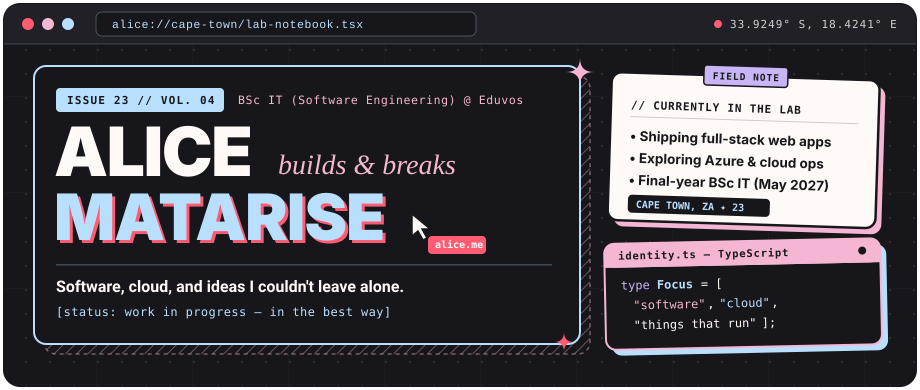
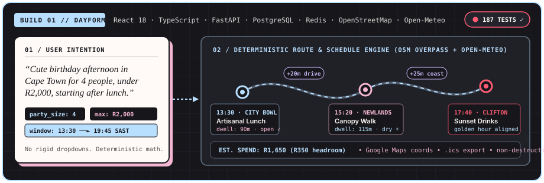
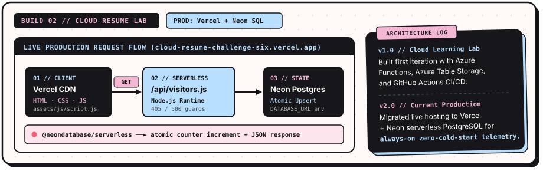
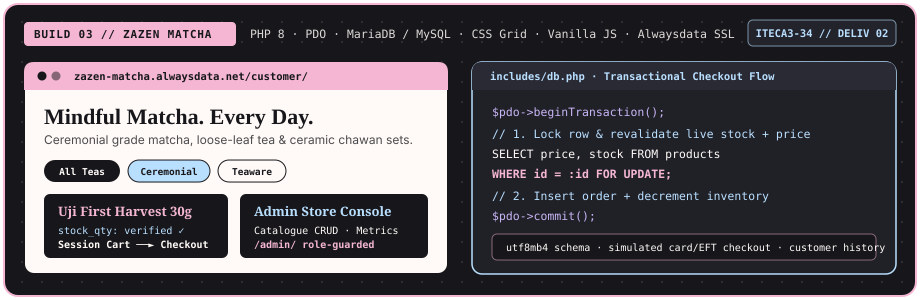
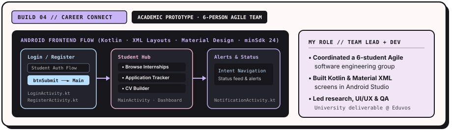
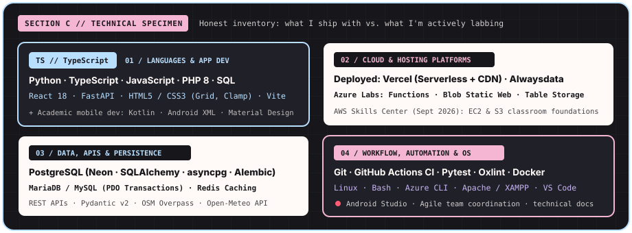
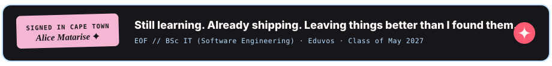

<div align="center">
  
  <br />
  
</div>

<p align="center">
  <sub>
    <code>INDEX //</code>&nbsp;&nbsp;
    <a href="https://cloud-resume-challenge-six.vercel.app/"><strong>01 · LIVE PORTFOLIO ↗</strong></a>
    &nbsp;&nbsp;✦&nbsp;&nbsp;
    <a href="https://dayform-live.vercel.app/"><strong>02 · DAYFORM APP ↗</strong></a>
    &nbsp;&nbsp;✦&nbsp;&nbsp;
    <a href="https://zazen-matcha.alwaysdata.net/"><strong>03 · ZAZEN MATCHA ↗</strong></a>
    &nbsp;&nbsp;✦&nbsp;&nbsp;
    <a href="https://www.linkedin.com/in/alice-matarise-778bb6374/"><strong>04 · LINKEDIN ↗</strong></a>
  </sub>
</p>

<br />

## `SECTION A // THE INTRODUCTION`

### Curious by default. Building as I go.

I’m **Alice Matarise**—a 23-year-old final-year **BSc Information Technology (Software Engineering)** student at **Eduvos** in Cape Town (graduating **May 2027**).

My favourite part of software engineering is the moment an idea stops being a neat local prototype and has to survive real constraints: database transactions, API latency, environment variables, CI checks, and human beings clicking buttons you didn't expect them to click. Right now, I’m splitting my time between shipping full-stack web applications and digging into cloud infrastructure, serverless deployment, and technical operations.

> **`// LAB METADATA`**  
> `location` **Cape Town, South Africa** *(SAST / UTC+2)* · `stage` **Final-Year BSc IT (Software Engineering) @ Eduvos** *(May 2027)*  
> `focus` **Full-stack software that works + cloud infrastructure that stays up**  
> `habit` *Build it, test it, break it in staging, figure out why, document the fix.*

<br />

## `SECTION B // THINGS I'VE BUILT`

Every project below started with a different question—from deterministic city itinerary math to serverless telemetry, transactional e-commerce, and coordinating a six-person Agile university team.

---

### `01 // FLAGSHIP LAB` — [Dayform](https://dayform-live.vercel.app/)

<p>
  <a href="https://dayform-live.vercel.app/">
    
  </a>
</p>

<p>
  <sub>
    <strong>LIVE APP:</strong> <a href="https://dayform-live.vercel.app/">dayform-live.vercel.app ↗</a>
    &nbsp;&nbsp;│&nbsp;&nbsp;
    <strong>SOURCE:</strong> <a href="https://github.com/SimplyAlice/dayform">github.com/SimplyAlice/dayform ↗</a>
    &nbsp;&nbsp;│&nbsp;&nbsp;
    <strong>ROLE:</strong> Solo Full-Stack Builder
  </sub>
</p>

> *“I have R400 and 3 hours in Cape Town—what can I actually do?”*

Saved bookmarks and generic chat lists don't make a real plan; they ignore whether a kitchen closes at 15:00, how long it takes to get from the City Bowl to Newlands, or how much headroom is left in your budget. **Dayform** is a Cape Town outing-planning system that turns plain-language intentions into chronological, budget-aware itineraries grounded in real place and weather data.

- **What it explores:** How to combine natural-language intent parsing with **deterministic planning rules**—enforcing real venue operating hours, contextual dwell times, neighbourhood travel buffers, hard budget ceilings, and non-destructive schedule adaptation when plans shift (like running 45 minutes late or incoming rain via Open-Meteo).
- **My contribution:** Architected and built the application end-to-end across a Clean Architecture Python backend and React/TypeScript frontend, including spatial venue lookup via OpenStreetMap Overpass, `.ics` RFC-5545 calendar export, direct Google Maps coordinate routing, and a 187-test Pytest suite wired into GitHub Actions CI.
- **Stack:** `TypeScript` · `React 18` · `Vite` · `Python` · `FastAPI` · `PostgreSQL (SQLAlchemy + asyncpg + Alembic)` · `Redis` · `OpenStreetMap Overpass` · `Open-Meteo` · `Vercel`

<details>
  <summary><code>[+ PEEK UNDER THE HOOD: WHY DETERMINISTIC PLANNING?]</code></summary>
  <br />
  Instead of letting an LLM guess opening hours or invent street addresses, Dayform separates <strong>intent extraction</strong> (party size, time window, budget ceiling, vibe exclusions) from <strong>schedule math</strong>. Venue coordinates and operating hours come from OpenStreetMap Overpass and a verified Cape Town fallback catalogue; if a phone number or price isn't known, the system marks it <code>UNKNOWN</code> rather than fabricating data.
</details>

<br />

---

<div align="right">

### `02 // CLOUD & TELEMETRY` — [Cloud Resume Challenge](https://cloud-resume-challenge-six.vercel.app/)

<sub>
  <strong>LIVE PORTFOLIO:</strong> <a href="https://cloud-resume-challenge-six.vercel.app/">cloud-resume-challenge-six.vercel.app ↗</a>
  &nbsp;&nbsp;│&nbsp;&nbsp;
  <strong>SOURCE:</strong> <a href="https://github.com/SimplyAlice/Cloud-Resume-Challenge">github.com/SimplyAlice/Cloud-Resume-Challenge ↗</a>
</sub>

</div>

<p>
  <a href="https://cloud-resume-challenge-six.vercel.app/">
    
  </a>
</p>

My cloud-focused portfolio and interactive resume, built around a simple question: *what actually happens between a browser page load, a serverless function, and a persistent cloud database?*

```diff
- v1 (Cloud Learning Lab) : Prototyped with Microsoft Azure (Azure Functions, Azure Table Storage, and GitHub Actions CI/CD) while learning serverless cloud fundamentals.
+ v2 (Current Production) : Hosted on Vercel with a Node.js serverless API route (/api/visitors) executing an atomic upsert against Neon serverless PostgreSQL.
```

- **How the live build works:** When the portfolio loads, `assets/js/script.js` calls `GET /api/visitors`. The serverless handler in `api/visitors.js` connects via `@neondatabase/serverless` using an environment-isolated `DATABASE_URL`, runs an atomic PostgreSQL upsert to increment and return the visitor count, enforces `HTTP 405` method guards, and degrades gracefully on the frontend if the database is unreachable.
- **Stack:** `HTML5` · `CSS3` · `JavaScript` · `Node.js Serverless Functions` · `Neon PostgreSQL` · `Vercel` · `Git & GitHub` *(+ `Azure Functions` & `Azure Table Storage` during v1 cloud lab iterations)*

<br />

---

### `03 // FULL-STACK E-COMMERCE` — [Zazen Matcha & Tea Co.](https://zazen-matcha.alwaysdata.net/)

<p>
  <a href="https://zazen-matcha.alwaysdata.net/">
    
  </a>
</p>

<p>
  <sub>
    <strong>LIVE STOREFRONT:</strong> <a href="https://zazen-matcha.alwaysdata.net/">zazen-matcha.alwaysdata.net ↗</a>
    &nbsp;&nbsp;│&nbsp;&nbsp;
    <strong>SOURCE:</strong> <a href="https://github.com/SimplyAlice/Zazen-Matcha">github.com/SimplyAlice/Zazen-Matcha ↗</a>
    &nbsp;&nbsp;│&nbsp;&nbsp;
    <strong>CONTEXT:</strong> Eduvos ITECA3-34 (Deliverable 2)
  </sub>
</p>

Built for **ITECA3-34: Web Development and e-Commerce Technologies** at Eduvos, **Zazen Matcha & Tea Co.** pairs a calm, editorial tea-house storefront with the relational database plumbing required to run an online shop without corrupting inventory.

| THE STOREFRONT EXPERIENCE (`/customer/`) | THE TRANSACTIONAL ENGINE (`/includes/` & `/admin/`) |
| :--- | :--- |
| **Catalogue & Ritual:** Category filtering, search, pagination, preparation notes, and a photographed chawan whisking loop. | **Atomic Checkout (`PDO`):** Revalidates live product prices and stock inside a SQL transaction (`SELECT ... FOR UPDATE`) before committing orders and decrementing inventory. |
| **Customer Accounts:** Registration, session authentication, profile management, order history, studio inquiries, and simulated card / bank-transfer checkout. | **Store Administration Console:** Separate role-guarded back office to inspect store metrics, manage products and categories (CRUD), and review customer orders. |

- **Stack:** `PHP 8` · `PDO` · `MariaDB / MySQL (utf8mb4)` · `HTML5` · `CSS3 (Grid)` · `Vanilla JavaScript` · `Apache` · `Alwaysdata (HTTPS/SSL)`

<br />

---

### `04 // AGILE TEAM PROTOTYPE` — Career Connect

<p>
  
</p>

<p>
  <sub>
    <strong>SCOPE:</strong> Collaborative University Software Engineering Project @ Eduvos
    &nbsp;&nbsp;│&nbsp;&nbsp;
    <strong>TEAM:</strong> 6-Person Agile Group
    &nbsp;&nbsp;│&nbsp;&nbsp;
    <strong>MY ROLE:</strong> Team Leader &amp; Android Frontend Developer
  </sub>
</p>

**Career Connect** is an academic Android application prototype designed to help students discover internships, track their applications, build CVs, and receive status alerts in one place. Rather than a commercial product launch, this project was a hands-on exercise in shipping working mobile software inside a six-student Agile team.

- **What I built & led:** Served as both **team leader / project manager** and **frontend Android developer**. I coordinated sprint tasks, research, UI/UX flows, and QA across our six-person group while implementing native Android screens (`LoginActivity`, `RegisterActivity`, `MainActivity`, `DashboardActivity`, `NotificationActivity`) and Material XML layouts in Android Studio.
- **Stack:** `Kotlin` · `Android XML Layouts` · `Material Design Components` · `AndroidX (AppCompat, ConstraintLayout)` · `Gradle (Kotlin DSL)` · `Android Studio` · `Git`

<br />

## `SECTION C // MY TECHNICAL WORLD`

<p>
  
</p>

I prefer being specific about what I’ve used to ship real projects versus what I’m actively practising in cloud labs and coursework:

**`[01] SHIPPED IN DEPLOYED PROJECTS`** *(daily drivers & production builds)*  
`TypeScript` · `Python (3.12+)` · `SQL` · `PHP 8` · `JavaScript` · `HTML5 / CSS3 (Grid, Fluid Clamp)` · `React 18` · `Vite` · `FastAPI` · `Pydantic v2` · `Node.js Serverless Routes` · `PostgreSQL (Neon, SQLAlchemy 2.0, asyncpg, Alembic)` · `MariaDB / MySQL (PDO Transactions)` · `Vercel` · `Alwaysdata` · `Git & GitHub Actions CI` · `Pytest` · `Oxlint`

**`[02] CLOUD, CACHING & INFRASTRUCTURE LABS`** *(hands-on labs, prototypes & active study)*  
`Microsoft Azure` *(Functions, Blob Static Website, Table Storage, Azure CLI)* · `AWS Skills Center` *(Sept 2026 — 4 classroom modules covering Cloud Fundamentals, Amazon S3 & EC2)* · `Redis` *(TTL session caching)* · `Docker` · `Linux / Bash` · `Apache / XAMPP`

**`[03] MOBILE & UNIVERSITY ENGINEERING FOUNDATION`** *(academic projects & coursework)*  
`Kotlin` · `Android Studio` · `Material Design XML Layouts` · `Gradle (Kotlin DSL)` · `REST API Design` · `Systems Analysis & Design` · `Database Systems` · `Network Security` · `Web Server Management` · `Operating Systems`

<br />

## `SECTION D // WHAT I'M EXPLORING NEXT`

I’m in the final stretch of my software engineering degree at Eduvos (graduating **May 2027**) and working toward early-career opportunities in **cloud support, cloud engineering, and technical operations**.

Because I started by building full-stack applications from scratch, I naturally care about what happens *after* code is written: how services are deployed, why an API route fails under edge cases, how environment secrets and database connections are managed safely, and how good observability makes debugging less painful.

- **On my study desk right now:** Preparing for the **Microsoft Azure Fundamentals (`AZ-900`)** certification, with **Azure Administrator (`AZ-104`)** queued as my next milestone after that.
- **How I’m practising:** Turning every project into an operations lab—writing real CI workflows, testing failure paths (`HTTP 405`/`500` handling, fallback data catalogues), and keeping documentation honest.

<br />

## `SECTION E // CLOSING NOTE`

<p align="center">
  
</p>

<p align="center">
  <sub>
    Built by <strong>Alice Matarise</strong> in Cape Town &nbsp;✦&nbsp;
    <a href="https://cloud-resume-challenge-six.vercel.app/">Portfolio</a> &nbsp;·&nbsp;
    <a href="https://dayform-live.vercel.app/">Dayform</a> &nbsp;·&nbsp;
    <a href="https://zazen-matcha.alwaysdata.net/">Zazen Matcha</a> &nbsp;·&nbsp;
    <a href="https://www.linkedin.com/in/alice-matarise-778bb6374/">LinkedIn</a>
  </sub>
</p>
